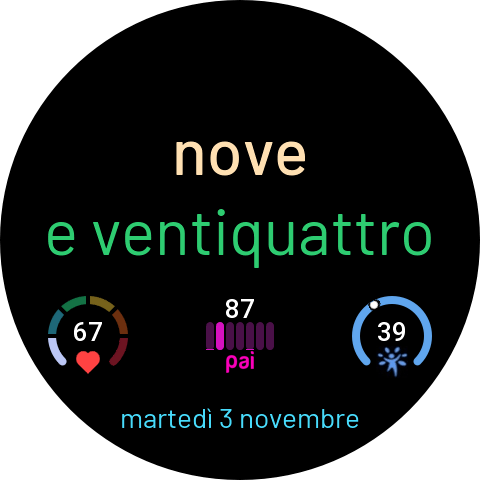
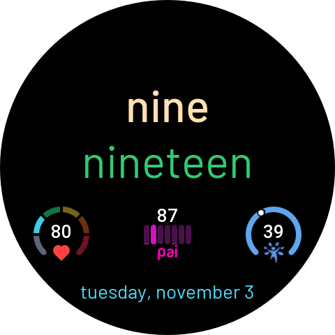
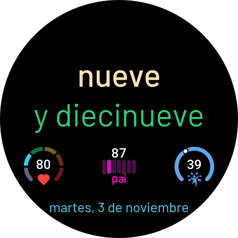
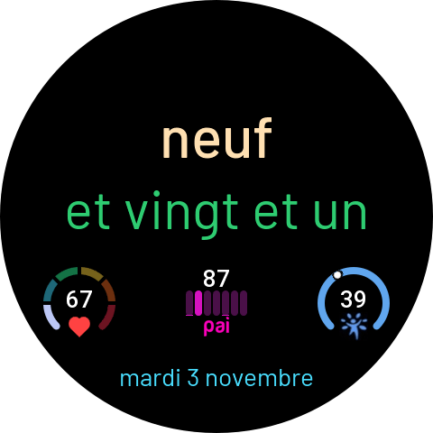
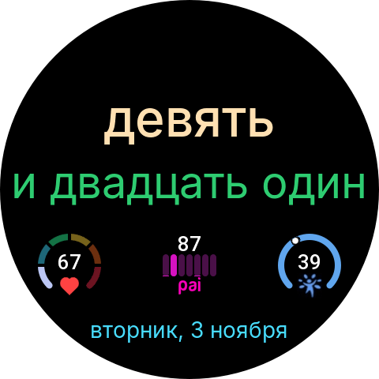

# TextWatch — the time, in words

A ZeppOS watchface that tells the time as written words, in your language.


Born as an Italian-only text watch, it now speaks **Italian, English, Spanish, French and Russian** — the language is picked automatically from the watch system language (English is the fallback, including for languages not yet supported, like Turkish).

| Language | Example (14:57) |
|----------|-----------------|
| 🇮🇹 Italiano | `quattordici` / `e cinquantasette` |
| 🇬🇧 English  | `two` / `fifty-seven` |
| 🇪🇸 Español  | `dos` / `y cincuenta y siete` |
| 🇫🇷 Français | `deux` / `et cinquante-sept` |
| 🇷🇺 Русский  | `два` / `и пятьдесят семь` |

On the watch:

<table>
  <tr>
    <td align="center"><br>Italiano</td>
    <td align="center"><br>English</td>
    <td align="center"><br>Español</td>
    <td align="center"><br>Français</td>
    <td align="center"><br>Русский</td>
  </tr>
</table>

Each language gets proper idiomatic forms, not literal translations: `mezzogiorno`/`noon`/`mediodía`/`midi`/`полдень`, quarter hours (`e un quarto`, `y media`, `et quart`, `и четверть`…), Italian phonetic elisions (`ventotto`, `trentuno`) and accented compounds (`trentatré`), French's non-hyphenated "et un" (`vingt et un`, not `vingt-un`), Russian genitive months in dates.

Italian hours use 24-hour words from 13 to 23 (`tredici`, `ventitré`), with `una` for 1 and `mezzogiorno` / `mezzanotte` for 12 and 0. The other languages use 12-hour words, except for French `treize` at 13.

Russian text renders in [Inter](https://github.com/rsms/inter) instead of the watch's default Barlow font, which has no Cyrillic glyphs — bundled as a Latin+Cyrillic subset to keep the package small.

## Features

- **Time as words** — hours and minutes spelled out, with a smooth slide-in animation on every minute change
- **Localized date** — e.g. `venerdì 26 gennaio`, tap it to open the calendar
- **Always-on display** — dedicated thin-font layout
- **11 backgrounds** — 6 dark + 5 light, selectable in the watchface editor; widget text automatically switches to dark on light backgrounds
- **Per-zone colors** — hour, minute and date colors are independently customizable, with live localized previews in the editor, rendered at the same font size shown on the watch face
- **5 widget slots** — 4 on the bottom row + 1 top-center, each configurable from ~28 data widgets (or left empty); non-empty bottom slots re-space themselves automatically
- **Tap-to-open** — every widget opens its system app (heart rate, weather, alarm…)

### Available widgets

Heart rate, steps, calories, battery, distance, standing hours, PAI (daily arc or weekly bar chart), SpO2, stress, sleep, body/ambient temperature, weather, humidity, wind (speed + direction), UV index, moon phase, sun arc (sunrise/sunset with day-progress dial), BioCharge, VO2max, recovery time, training load, fat burn, altimeter, altitude, stopwatch, countdown, alarm.

## Supported devices

Round ZeppOS 3.0+ watches. Primary target is the **Amazfit Balance** (480×480); dedicated targets cover 466, 454, 416 and 360 px round screens.

## Building

Requires the [Zeus CLI](https://docs.zepp.com/docs/guides/tools/cli/):

```bash
npm i -g @zeppos/zeus-cli
zeus dev      # run in the simulator / preview on a paired watch
zeus build    # produce the installable package
```

The images are drawn at 480 px in `assets/default-target.r/`. The 466, 454, 416 and 360 px targets get scaled copies in `assets/target-<width>/`, committed to the repository: Zeus takes a target's assets only from its own folder and does not scale them. After changing any image (or font) in `default-target.r`, regenerate them with Node (it uses `sharp` from the Zeus CLI install):

```bash
node tools/gen_targets.cjs              # all targets
node tools/gen_targets.cjs target-416   # just one
```

## Project layout

```
watchface/
  index.js          # layout, animations, AOD, editor groups
  numberToText.js   # number → words engine (it / en / es / fr / ru)
  colorSelector.js  # per-zone color pickers with localized previews
  editTypesUtil.js  # the ~28 data widgets renderers
  backgrounds.js    # background catalog (dark / light)
tools/              # Python generators for backgrounds and editor previews
  gen_color_previews.py  # renders the per-language, per-color preview PNGs
                          # from ALL_COLORS in colorSelector.js
  gen_targets.cjs   # scales default-target.r into the smaller targets (Node)
assets/
  default-target.r/ # 480 px images and fonts, the source
    bg/color/{it,en,es,fr,ru}/  # localized color-picker previews
  target-<width>/   # generated by gen_targets.cjs, except each preview.png
```
